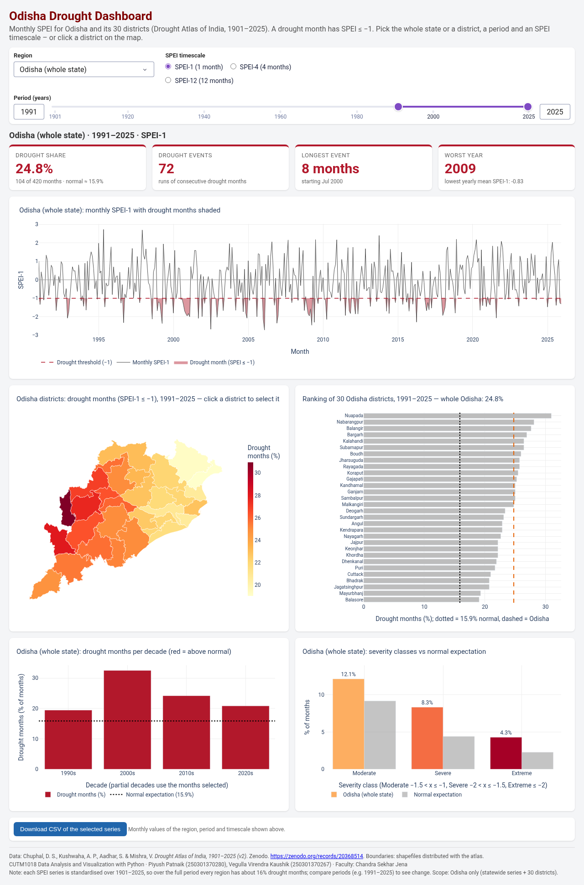
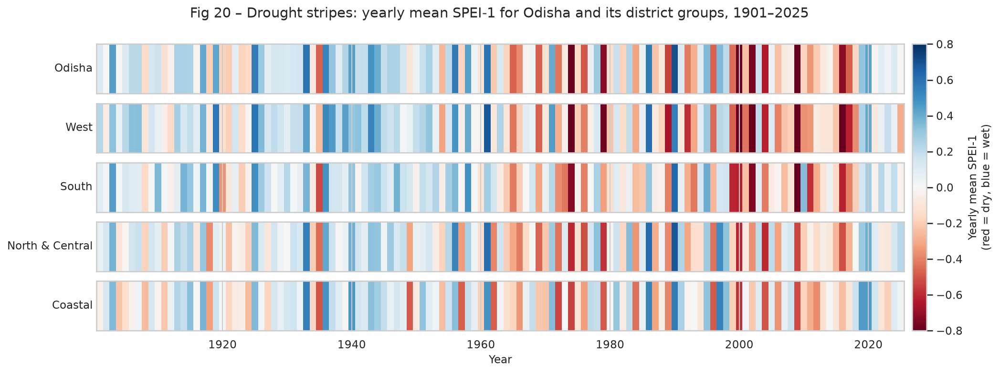
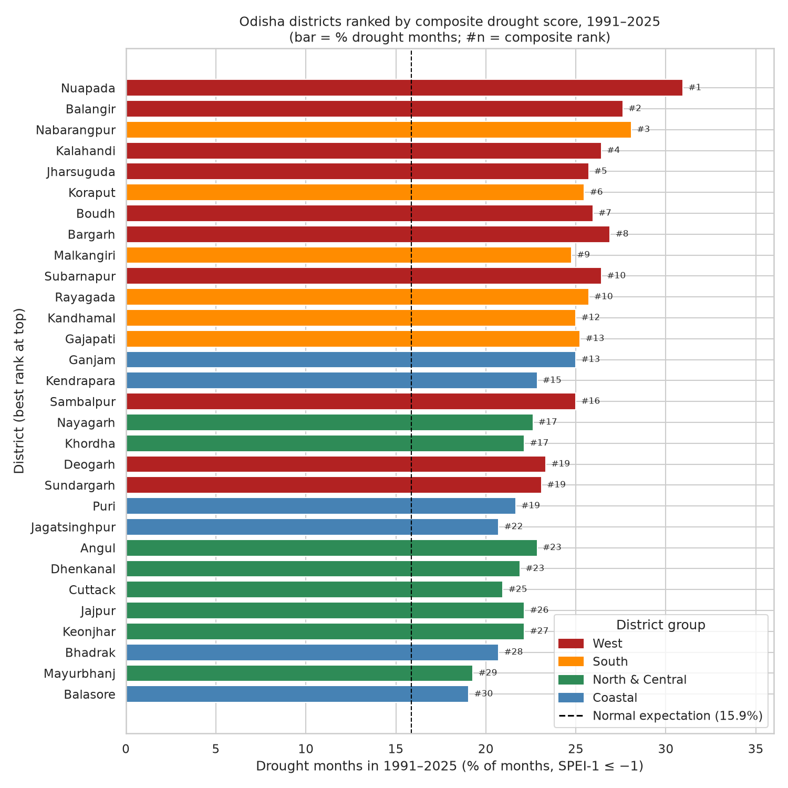
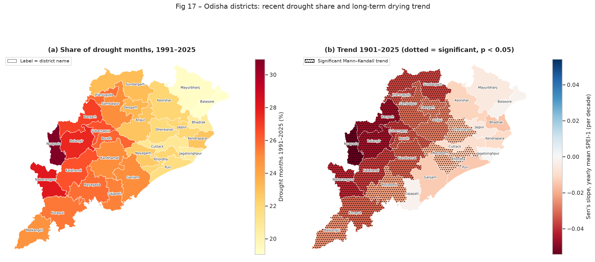

# Odisha Drought Analysis (SPEI, 1901–2025)

**Has drought in Odisha become more common, and where in the state is it worst?** This project answers that question with monthly
SPEI (Standardised Precipitation-Evapotranspiration Index) data from the Drought Atlas of India for 1901–2025. It covers the
Odisha statewide series and all 30 districts. The work goes from data cleaning through exploratory analysis with statistical
tests and a set of charts and district maps, then AI-assisted summarisation with a fact-checker, and ends with an interactive
Plotly Dash dashboard.

**Live dashboard: <https://piyushpatnaik.pythonanywhere.com/>** — hosted on a free PythonAnywhere account, so the first load
can be a little slow, and the site has to be renewed from the PythonAnywhere *Web* tab before it expires (free web apps
run for a limited period at a time). Hosting notes: [`DEPLOY_PYTHONANYWHERE.md`](DEPLOY_PYTHONANYWHERE.md).



## Course and team

- **Course:** CUTM1018 Data Analysis and Visualization with Python
- **Team:**
  - Piyush Patnaik (250301370280)
  - Vegulla Virendra Kaushik (250301370267)
- **Faculty:** Chandra Sekhar Jena

## Key findings

A **drought month** is a month with SPEI-1 ≤ −1. Each SPEI series is standardised over 1901–2025, so over the whole record every
area has about 16% drought months. Changes therefore show up when you **compare periods**: early (1901–1960) vs recent (1991–2025).
Every number below is listed, with its fact name, in [`reports/ODISHA_ONLY_FACTS.md`](reports/ODISHA_ONLY_FACTS.md).

1. **Drought has become much more common in Odisha.** Drought months rose from 9.4% (1901–1960) to 24.8% (1991–2025)
   (χ² = 47.4, p ≈ 6 × 10⁻¹²). The 2000s were the worst decade, with 39 of 120 months (32.5%) in drought. The yearly mean SPEI-1
   shows a significant drying trend (Mann–Kendall tau = −0.218, p = 0.0003).
2. **Most of the rise is outside the monsoon.** Between the two periods, winter drought months went from 4.2% to 37.1% and
   post-monsoon from 6.1% to 26.7%. The monsoon only went from 13.8% to 17.1%.
3. **Western Odisha is the hotspot.**
   - 19 of the 30 districts show a significant drying trend. That includes all 10 western districts and none of the 6 coastal ones.
   - In 1991–2025 the western districts averaged 26.1% drought months against 21.7% on the coast
     (Welch t-test p = 0.0017; Mann–Whitney p = 0.0033).
   - Nuapada went from 5.6% to 31.0% and is the most drought-prone district (composite rank 1). Balasore ranks last (30th, 19.0%).
4. **Every district got drier.** All 30 districts had more drought months in 1991–2025 than in 1901–1960. The districts follow the
   statewide series closely (mean r = 0.84, lowest 0.69 for Malkangiri). During a statewide drought month, on average 21.4 of the
   30 districts are in drought too.

<p>


</p>



## Repository structure

```
odisha-drought-analysis/
├── app.py                        # Plotly Dash dashboard
├── dashboard/
│   ├── data.py                   # loading, selection, KPIs, drought events
│   ├── figures.py                # one function per dashboard chart
│   └── make_geojson.py           # one-off: shapefile -> data/clean/geo/odisha_districts.geojson (needs raw data)
├── assets/style.css              # dashboard styling
├── notebooks/
│   ├── 01_data_loading_cleaning_eda.ipynb   # Week 2: loading, cleaning, first EDA (needs raw data)
│   ├── 02_full_eda.ipynb                     # Week 3: full EDA and statistical tests (clean data only)
│   ├── 03_visualizations.ipynb               # Week 4: advanced charts and district maps (needs raw data)
│   └── 04_ai_integration.ipynb               # Week 5: AI prompts, baseline summary, fact-checker (clean data only)
├── data/
│   ├── raw/
│   │   ├── HOW_TO_GET_RAW_DATA.txt           # download and extract instructions
│   │   └── DroughtAtlas_v2/readme            # readme that ships with the atlas
│   └── clean/                    # cleaned Odisha tables and analysis results (CSV), geo/odisha_districts.geojson
├── reports/
│   ├── ODISHA_ONLY_FACTS.md      # the 265 key numbers behind the text
│   ├── ai/fact_catalogue.csv     # fact catalogue used by notebook 04
│   └── figures/                  # all figures (fig01–fig27) and dashboard screenshots
├── tests/
│   ├── test_dashboard.py         # callback tests + KPI cross-check (no server needed)
│   └── http_and_screenshots.py   # optional HTTP checks and screenshots (needs a running app + Playwright)
├── requirements.txt              # pinned environment (Python 3.13)
├── requirements-user.txt         # looser versions for your own computer (Python 3.10–3.13)
├── RUN_ON_YOUR_DEVICE.md         # step-by-step guide for Windows and Mac, with troubleshooting
└── LICENSE
```

## Dataset

**Drought Atlas of India, 1901–2025 (version 2)** by Chuphal, D. S., Kushwaha, A. P., Aadhar, S. and Mishra, V.
(IIT Gandhinagar / IIT Jodhpur). Zenodo: <https://doi.org/10.5281/zenodo.20368514>
(record <https://zenodo.org/records/20368514>). Licence: CC BY 4.0.

- We use the ready-made area averages for Odisha only: the Odisha file in `Z-score/States` and the 30 Odisha files in
  `Z-score/Districts` (monthly SPEI-1, SPEI-4 and SPEI-12). We also use the ID lookup files and the district shapefile.
- **The raw data is not in this repository.** The source zip is about 3 GB.
- The cleaned tables in [`data/clean/`](data/clean/) (about 6 MB) are included, so most of the project runs without the raw data.

| Part | Needs the raw data? |
|---|---|
| `notebooks/01_data_loading_cleaning_eda.ipynb` | Yes |
| `notebooks/03_visualizations.ipynb` (district maps) | Yes |
| `notebooks/02_full_eda.ipynb` | No, uses `data/clean/` |
| `notebooks/04_ai_integration.ipynb` | No, uses `data/clean/` |
| Dashboard (`app.py`) and tests | No, uses `data/clean/` |

Without the raw data, notebook 01 stops at its first code cell with a clear message. Notebook 03 runs until it reaches the
district shapefile and then fails with a file-not-found error.

### Getting the raw data

1. Download `DroughtAtlas_v2.zip` from <https://zenodo.org/records/20368514>.
2. From the `data/raw/` folder, extract only the parts that are used:

   ```bash
   unzip DroughtAtlas_v2.zip "DroughtAtlas_v2/readme" \
     "DroughtAtlas_v2/Z-score/States/*" \
     "DroughtAtlas_v2/Z-score/Districts/*" "DroughtAtlas_v2/Z-score/*.xlsx" \
     "DroughtAtlas_v2/Administrative-Boundaries_Shapefile/STATE_BOUNDARY*" \
     "DroughtAtlas_v2/Administrative-Boundaries_Shapefile/DISTRICT_BOUNDARY*"
   ```

   On Windows you can open the zip in File Explorer or 7-Zip and copy the same folders into `data/raw/DroughtAtlas_v2/`.
   `Gridded_SPEI/`, `Talukas/` and the atlas PNG maps are not needed.
3. Run notebook 01, then 02 and 03.

The full instructions are in [`data/raw/HOW_TO_GET_RAW_DATA.txt`](data/raw/HOW_TO_GET_RAW_DATA.txt). Everything under
`data/raw/DroughtAtlas_v2/` except the readme is ignored by git.

## Setup

You need Python 3.10–3.13. The project was built with Python 3.13.

```bash
git clone https://github.com/guguluP/odisha-drought-analysis.git
cd odisha-drought-analysis
```

**Mac / Linux (Terminal):**

```bash
python3 -m venv .venv
source .venv/bin/activate
python -m pip install --upgrade pip
pip install -r requirements-user.txt
python -m ipykernel install --user --name drought
```

**Windows (PowerShell):**

```powershell
python -m venv .venv
.venv\Scripts\Activate.ps1
python -m pip install --upgrade pip
pip install -r requirements-user.txt
python -m ipykernel install --user --name drought
```

Some notes:

- On Windows, tick "Add python.exe to PATH" when you install Python. If PowerShell says scripts are disabled, run
  `Set-ExecutionPolicy -Scope CurrentUser RemoteSigned` once, or use cmd with `.venv\Scripts\activate.bat`.
- On a Mac, use `python3` if `python` is not found.
- If `geopandas` fails to install on Windows, upgrade pip and try again, or use Anaconda with
  `conda install -c conda-forge geopandas`.
- `requirements.txt` has the exact pinned versions we used (Python 3.13). Use it instead of `requirements-user.txt` if you
  want the same environment.

[`RUN_ON_YOUR_DEVICE.md`](RUN_ON_YOUR_DEVICE.md) has a longer step-by-step guide, a troubleshooting table, and notes for
Anaconda, VS Code and Google Colab.

## Running the notebooks

Start Jupyter from the project folder with the venv active:

```bash
jupyter notebook
```

Open a notebook in `notebooks/`, choose the **drought** (or Python 3) kernel, then use **Kernel → Restart & Run All**.
Figures are saved in `reports/figures/`. Run them in order: 01 → 02 → 03 → 04. Without the raw data, run only 02 and 04.

You can also run them from the command line:

```bash
jupyter nbconvert --to notebook --execute --inplace notebooks/02_full_eda.ipynb
jupyter nbconvert --to notebook --execute --inplace notebooks/04_ai_integration.ipynb
```

## Running the dashboard

```bash
python app.py
```

Then open <http://127.0.0.1:8050>. Press Ctrl+C to stop it. To use another port, run `PORT=8060 python app.py` on Mac/Linux
or `$env:PORT=8060; python app.py` in Windows PowerShell.

What the dashboard does:

- You can pick a region (whole Odisha or one of the 30 districts), the SPEI timescale (1, 4 or 12 months) and a period of years.
- Clicking a district on the map selects it. The map and the ranking bar show all 30 districts.
- KPI cards show the drought share, the number of drought events, the longest event and the worst year.
- There are charts for the monthly series, drought months per decade and severity classes.
- A button downloads the series shown as CSV.

## Running the tests

```bash
python tests/test_dashboard.py
```

This calls every dashboard callback with many input combinations and checks the KPI numbers against the clean tables and
`reports/ODISHA_ONLY_FACTS.md`. It needs no server or browser and should end with `ALL TESTS PASSED`.

`tests/http_and_screenshots.py` is optional. It checks a running app over HTTP and takes browser screenshots:

```bash
pip install playwright==1.63.0 requests==2.34.2
python -m playwright install chromium
python app.py        # in a second terminal
python tests/http_and_screenshots.py
```

## Tools used

- Python, pandas, NumPy, SciPy (statistical tests)
- Matplotlib, Seaborn, Plotly
- GeoPandas, Shapely, pyogrio, pyproj (district maps)
- Plotly Dash (dashboard)
- Jupyter Notebook
- Git and GitHub
- An AI assistant (Grok Bot) helped plan the analysis, write code and notebook text, and check figures. Every number in the text
  comes from executed code. Notebook 04 recomputes all 265 facts in `reports/ODISHA_ONLY_FACTS.md` from the monthly tables and
  checks them.

## Limitations

- The study covers Odisha only (the statewide series and its 30 districts). There is no comparison with other states.
- It uses the published SPEI area averages from the atlas. It does not compute drought indices from station rainfall, and the
  atlas has no rainfall variable.
- Each SPEI series is standardised over 1901–2025, so the long-run drought share is about 16% everywhere by design. Only
  comparisons between periods show change.
- SPEI-4 and SPEI-12 are missing for the first months of 1901 (3 and 11 months), because they need earlier months to compute.
- This is a descriptive analysis. It does not attribute the changes to any cause, such as climate change.
- The planned comparison of AI tools (ChatGPT, Gemini, Claude) has not been done yet.

## License

The code is released under the **MIT License**. See [`LICENSE`](LICENSE).

The data is not covered by the MIT License. The Drought Atlas of India is licensed **CC BY 4.0** by its authors. The tables in
`data/clean/`, the boundary file in `data/clean/geo/` and the figures are derived from it, so any reuse must credit:

> Chuphal, D. S., Kushwaha, A. P., Aadhar, S., & Mishra, V. *Drought Atlas of India, 1901–2025* (Version 2) [Data set].
> Zenodo. https://doi.org/10.5281/zenodo.20368514
